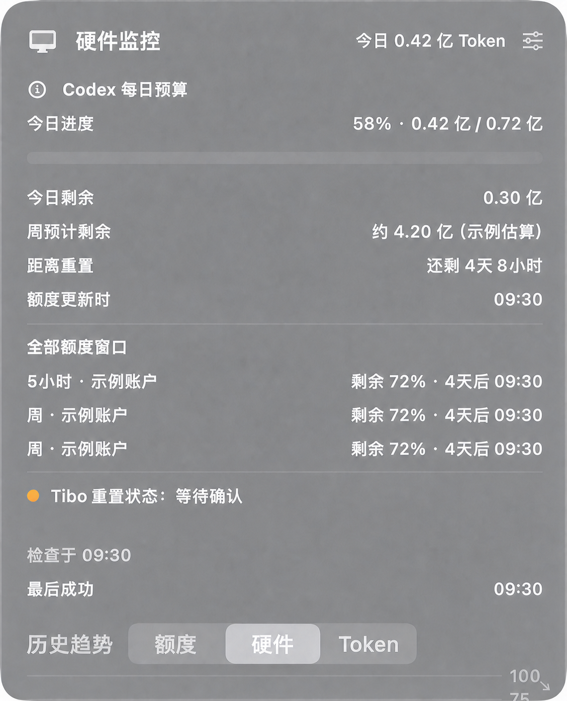
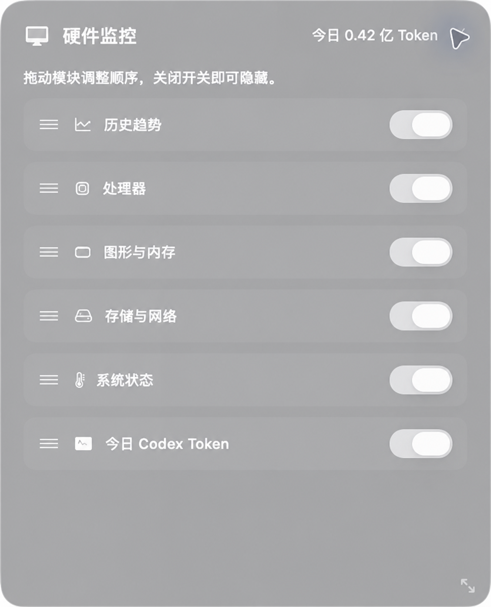

# NotchHub macOS ✨

<p align="center">
  
</p>

<p align="center">
  <a href="LICENSE"></a>
  
  
</p>

把 MacBook 刘海变成一个真正有用的信息中心：不听歌时看 Codex 额度和内存，播放 QQ 音乐时看同步歌词，需要细节时再打开中文硬件面板。

这个项目的灵感和基础来自 [TheBoredTeam/boring.notch](https://github.com/TheBoredTeam/boring.notch)，在它优秀的刘海交互上加入了我日常真正需要的 Codex、歌词、硬件监控和快捷工具。

## 📸 界面

截图来自实际运行界面，其中账号和额度数字已换成示例数据。

<p align="center">
  
  &nbsp;&nbsp;
  
</p>

## 🌟 功能

### 🤖 Codex 额度常驻刘海

- 没有播放音乐时，闭合刘海持续显示 Codex 主额度和当前内存占用。
- 自动识别 Plus、Pro 和 Pro Lite：Plus 优先显示 5 小时额度，Pro 系列优先显示周额度。
- 展开后可以看到全部额度窗口、剩余比例、重置倒计时和最近更新时间。
- 支持紧凑、标准、信息增强三种中文布局。
- 鼠标移出详情页后会自动收起，不会再卡在屏幕固定位置。

### 🔮 Tibo 重置雷达

Tibo 偶尔会进行服务器端硬重置。NotchHub 会每小时查看一次公开事件，同时在启动和 Mac 唤醒后补查：

- 发现 `RESET_PLANNED` 时，在硬件面板展示“可能发生硬重置”、事件标题、发布时间和来源链接，方便判断大概会在什么时候重置。
- 只处理真正的硬重置，自动排除 banked reset / 储备重置。
- 发现可信的 `RESET_COMPLETED` 后发送一次通知，并进入“等待额度同步”状态。
- 当 Codex 剩余额度回升至少 20%，或额度窗口的重置时间发生变化时，确认重置已经同步。
- 同步完成后自动清空旧预算状态，重新计算当日可用额度。
- 接口暂时失败时会保留最后一次成功结果，并按 5 分钟、15 分钟、1 小时逐步退避重试。

面板会把“计划中、已宣布、等待同步、已同步”分开显示。这样既能提前看到可能的重置窗口，也能知道额度是否真的到账。

### 📊 Token 统计与额度预估

- 增量读取本机 `~/.codex/sessions` 和 `~/.codex/archived_sessions`，首次扫描后只处理新增 JSONL 数据。
- 对事件去重，分别统计输入、缓存输入、输出和推理 Token。
- 所有 Token 数量统一使用“亿”，更适合查看大额度。
- 保存 30 天额度样本，用最近 12 个兼容样本的中位数估算每 1% 对应的 Token。
- 显示预计剩余额度、估算区间、样本数和中文置信度。
- 根据消耗速度估算额度会不会在重置前用完，并给出预计耗尽时间。
- 其他设备产生、但本机日志里找不到的消耗会单独标记为“未归因估算”，不会混进本机精确统计。

### 🎯 每日额度预算

- 根据周剩余额度和距离重置的时间，自动分配每天可用的 Token。
- 每日预算在本地午夜锁定，白天不会因为短时波动反复改变。
- 当日没用完的空间会进入下一天的重新分配。
- 新额度周期或 Tibo 硬重置同步后会立即重建预算。
- 只在用量达到当日预算的 100% 和 150% 时各提醒一次，没有多余通知。

### 🎵 QQ 音乐同步歌词

- 播放音乐时，歌词优先显示在灵动岛，暂停后恢复 Codex 额度与内存。
- 优先适配 QQ 音乐，通过 macOS Now Playing / MediaRemote 获取当前歌曲。
- 使用严格的歌曲匹配查找同步歌词；没有匹配结果时显示歌曲标题。
- 切歌会取消上一首的过期请求，已经验证的歌词保存在本地缓存中。
- 专辑封面、播放控制和可视化效果继续保留。

### 🖥️ 中文硬件桌面面板

- CPU 占用、核心数与系统负载。
- GPU 型号、内存占用、内存压力、压缩内存和 Swap。
- 磁盘剩余空间、实时下载与上传速度。
- 电池电量、健康度、循环次数、温度状态与系统运行时间。
- 额度、硬件和 Token 三种历史趋势图。
- 面板可以常驻桌面、自由缩放和纵向滚动。
- 六个模块可以显示或隐藏，也可以拖动排序；布局会自动保存。
- 数据源出错时显示最后成功值和过期状态，不会让整个面板突然空白。

### ⌨️ 两个实用快捷键

- `⌃⌥A`：打开 macOS 应用启动台，快速找到所有已安装应用。
- `⌃⌥S`：打开系统截图与录屏工具栏。
- 两个快捷键都可以在设置中修改。

### 🧰 其他功能

- 刘海音乐控制、专辑封面、进度条和动态可视化。
- 文件暂存架、拖放和 AirDrop 分享。
- 系统音量、亮度和键盘背光 HUD。
- 日历、提醒事项和充电状态 Live Activity。
- 摄像头镜子、手势操作、多显示器和刘海尺寸微调。
- 菜单栏设置、登录启动和 Sparkle 更新检查。

### 🍃 尽量少占资源

- Codex 额度与 Token 增量统计每 10 分钟刷新一次，打开刘海或面板时按需刷新。
- 内存摘要每 10 秒更新。
- 硬件面板可见时通常每 5 秒采样，短时间需要更顺滑时可提升到 2 秒。
- 面板隐藏、被遮挡、低电量或温控受限时降到 15 秒。
- 屏幕关闭或用户会话锁定时暂停硬件采样。

## 🚀 构建与运行

### 环境

- macOS 14 Sonoma 或更高版本
- Apple Silicon 或 Intel Mac
- 完整版 Xcode，建议 Xcode 26 或更高版本
- 使用 Codex 功能前，需要本机 Codex 已登录且 `codex app-server` 可用

### 克隆项目

```bash
git clone https://github.com/huchongying/notch-hub-macos.git
cd notch-hub-macos
open boringNotch.xcodeproj
```

在 Xcode 中选择 `boringNotch` Scheme，按 `⌘R` 运行。

也可以在终端做一次无签名 Release 构建：

```bash
xcodebuild \
  -project boringNotch.xcodeproj \
  -scheme boringNotch \
  -configuration Release \
  -derivedDataPath /tmp/NotchHubDerivedData \
  CODE_SIGNING_ALLOWED=NO \
  build
```

## 🔐 权限与数据

- **辅助功能**：全局快捷键、媒体按键与部分系统交互。
- **通知**：每日预算达到 100% / 150%，以及确认后的 Tibo 硬重置提醒。
- **网络**：同步歌词、Tibo 状态和版本更新。
- **日历、提醒事项、相机**：用于原项目中对应的日历、提醒和镜子功能。

Codex 额度来自本机已认证的 `codex app-server` 只读接口；Token 统计在本机完成。应用不会读取 Codex 登录 Token，也不会上传会话正文。完整说明见 [PRIVACY.md](PRIVACY.md)。

## 🧩 主要代码

- `boringNotch/models/ResourceStatsViewModel.swift`：Codex 额度、预估、每日预算和 Tibo 重置雷达。
- `boringNotch/models/CodexTokenStatsViewModel.swift`：本机 Token 增量统计与去重。
- `boringNotch/models/HardwareStatsViewModel.swift`：硬件采样和自适应刷新。
- `boringNotch/components/Hardware/HardwareDashboard.swift`：中文桌面面板与模块布局。
- `boringNotch/components/Notch/BoringHeader.swift`：刘海额度、内存、详情页和歌词显示。
- `boringNotch/managers/MusicManager.swift`：QQ 音乐元数据与同步歌词。
- `BoringNotchXPCHelper/CodexRateLimitProbe.swift`：Codex 本地额度读取。

## 🙌 感谢

- [MediaRemoteAdapter](https://github.com/ungive/mediaremote-adapter)：macOS Now Playing 元数据适配。
- [NotchDrop](https://github.com/Lakr233/NotchDrop)：文件架功能参考。
- [Codex Usage Bar](https://github.com/CMMUU/codex-usage-bar)：Codex 进程握手与可执行文件发现逻辑参考。

项目使用 [GPL-3.0](LICENSE) 许可证，第三方声明见 [THIRD_PARTY_LICENSES](THIRD_PARTY_LICENSES)。
